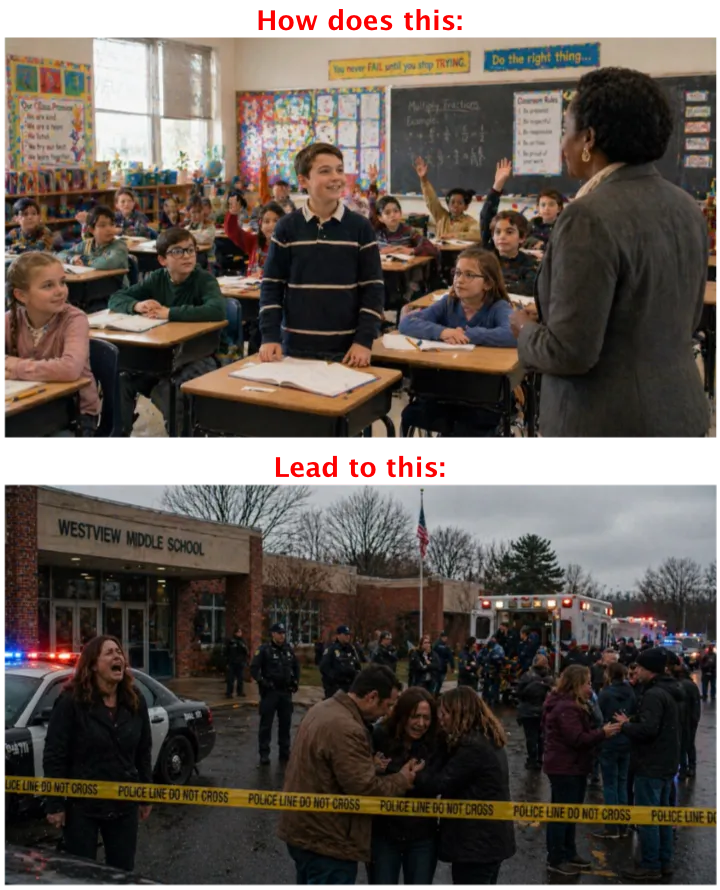

<figure class="sized" style="--w: 200px"></figure>

## About the Film

**What should be unthinkable has become routine.** *No Kidding Around* begins with three ordinary school days. A grade-school father and daughter share a small morning ritual. Two middle-school friends argue about the greatest basketball player of all time. Two high-school students tentatively discover a connection with each other. These are the moments childhood is made of: funny, awkward, tender and fleeting.

Then gun violence interrupts them. The violence itself is never the spectacle. Instead, the film remains with what has been interrupted and lost—and with the now-familiar responses that follow: grief, thoughts and prayers, explanations, rationalizations, and ultimately the return to ordinary life until it happens again.

<a class="btn btn-primary" href="https://fiscal.thegotham.org/film/5836/no-kidding-around" target="_blank" rel="noopener">Support the film</a><a class="btn" href="mailto:zog@thezog.com?subject=No%20Kidding%20Around%20%E2%80%94%20Screenplay%20Request">Request the screenplay</a><a class="btn" href="../../assets/files/no-kidding-around-pitch-deck.pdf">View the pitch deck (PDF)</a>

Fiscally sponsored by501(c)(3) tax-deductible

## Why This Film

**Weapons have been the leading cause of death for American youth since 2020.** While statistics, however grotesque, tell us the scale, stories can bring home the human loss.

*No Kidding Around* approaches the subject differently. It does not begin with guns, politics or policy. It begins with children. By first allowing us to know them in ordinary moments of humor, affection, friendship and possibility, the film asks the audience to experience not simply an act of violence, but **what that violence interrupts**.

<figure class="sized" style="--w: 440px"></figure>

## The Filmmakers

### Robert M. Herzog · Writer · Producer · Co-director

Robert M. Herzog is a novelist, screenwriter, playwright and filmmaker. He wrote, produced and directed the award-winning short film [*Flights*](read/flights/), which screened at numerous festivals, including the Hamptons and LA International Short Film Festival, and won Best Film — Short Subject at the Cinevue International Film Competition.

His screenwriting has also received recognition from Cinequest, the Los Angeles Independent Film Festival, New York Script Awards, Best Script Award London and other competitions.

His published works include his novel, [*A World Between*](index.html#book-a-world-between), a Barnes & Noble e-Book of the day, and [*Views from the Side Mirror*](index.html#book-views-from-the-side-mirror), an essay collection, as well as numerous short stories and poems. You can see more of Robert’s work on thezog.com website and at [linktr.ee/RobertMHerzog](https://linktr.ee/RobertMHerzog).

### Dean Imperial · Co-director

Dean Imperial is a screenwriter, director and producer whose feature film *CAPER* premiered at SXSW in 2025. His television writing credits include *Godfather of Harlem*, *Hotel Cocaine* and *Imposters*. He is represented by CAA and Untitled Entertainment.

## Current Status

Moving toward production

The screenplay is complete and was named a:

+ Finalist — Best Drama Screenplay, Fall 2026 Austin Short Film Festival
+ Semi-Finalist — Chicago Script Awards

*No Kidding Around* is currently in financing and pre-production, with a completed production plan, budget and pitch deck.

The film is fiscally sponsored by [The Gotham Film & Media Institute](https://fiscal.thegotham.org/film/5836/no-kidding-around).

## Explore / Get Involved

Learn more about *No Kidding Around*:

<a class="btn btn-primary" href="https://fiscal.thegotham.org/film/5836/no-kidding-around" target="_blank" rel="noopener">Support the film</a><a class="btn" href="mailto:zog@thezog.com?subject=No%20Kidding%20Around%20%E2%80%94%20Screenplay%20Request">Request the screenplay</a><a class="btn" href="../../assets/files/no-kidding-around-pitch-deck.pdf">View the pitch deck (PDF)</a>

---

**No Kidding Around**\
Written and produced by Robert M. Herzog\
Co-directed by Robert M. Herzog and Dean Imperial
